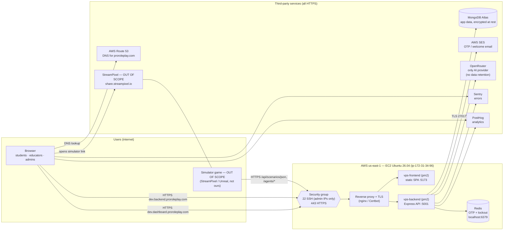

# Network diagram — Virtual Patient Simulator (dev)

ISO 27001 IRL #27. Last reviewed: 2026-11-12. Update whenever a host, port or third-party service changes.

GitHub renders the diagram below. To export it as an image for the auditor, paste the code block into https://mermaid.live and download PNG/SVG.

## Data flows

| From → To | Protocol / port | Data | Auth |
|---|---|---|---|
| Browser → AWS Route 53 | DNS 53 | Lookup of `*.proroleplay.com` (Route 53 is the only DNS provider for VPS) | Public DNS |
| Browser → dashboard / backend | HTTPS 443 | Logins, scenarios, sessions, student data | JWT (1 h), CORS allowlist (`CORS_ORIGINS`) |
| Game → backend `/api/scenarios/json`, `/agents/*` | HTTPS 443 | Scenario key, conversation turns | Scenario `api_key` + `session_id` (no user login) |
| Backend → MongoDB Atlas | TLS 27017 | All persistent data | Atlas DB user, IP access list |
| Backend → Redis | TCP 6379, localhost only | OTPs, login-lockout counters | Not exposed outside the instance |
| Backend → AWS SES | HTTPS | Recipient email, OTP / temporary password | IAM credentials |
| Backend → OpenRouter | HTTPS | Scenario text, conversation transcript | API keys |
| Backend + browser → Sentry / PostHog | HTTPS | Errors (user id, role); usage events | Project DSN / key |

## To confirm on the server (fill in, then delete this section)

- [ ] Reverse proxy and TLS actually in place (nginx + Certbot or an AWS load balancer)
- [ ] Ports 5001 / 5173 **not** open to the internet in the security group — only 443 (and 22 from admin IPs)
- [ ] Redis bound to 127.0.0.1
- [ ] Atlas IP access list limited to the EC2 instance's IP (no `0.0.0.0/0`)
